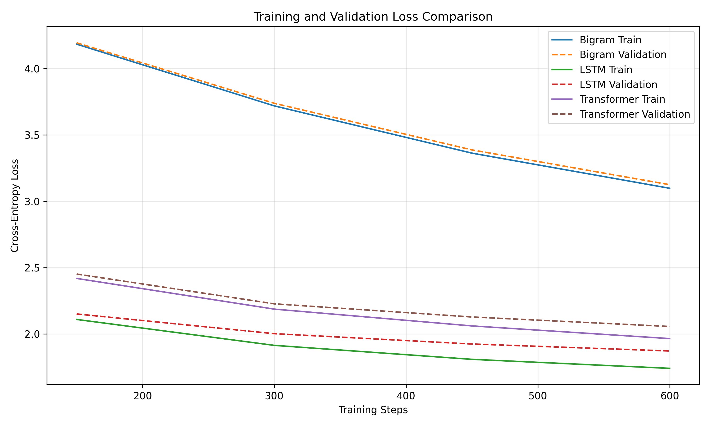

# NLP Midterm Project

# Project Overview

This project compares three language models used for the “character-based next-character prediction” task:

1. Bigram (bigram model)
2. LSTM (Long Short-Term Memory) model
3. Small Transformer model

The goal is to explore how different model structures process language and to evaluate the advantages offered by the “self-attention mechanism.”

# Dataset

Dataset: Tiny Shakespeare

Source:
https://github.com/karpathy/char-rnn/tree/master/data/tinyshakespeare

This dataset contains 1,115,394 characters, comprising a total of 65 different characters.

The dataset is split as follows:
- Training set: 1,003,854 characters (90%)
- Validation set: 111,540 characters (10%)

All models use the same dataset, vocabulary, and data split.

# Model Architectures

# 1. Bigram Model

The Bigram model predicts the next character based only on the current character.

It uses an embedding lookup table to learn transition scores between characters but does not consider longer-range contextual information.

# 2. LSTM Model

The LSTM model consists of an embedding layer, a cyclic LSTM layer, and an output layer.

It processes information from previous characters by maintaining hidden states and memory cells.

# 3. Small Transformer

This Transformer model consists of:
- Token embeddings
- Positional embeddings
- Two Transformer blocks
- Multi-head causal self-attention
- Feedforward layers
- Layer normalization
- Output layer

The self-attention mechanism allows the model to directly build associations between different positions within the context window.

# Training Configuration

- Framework: PyTorch
- Device: cpu
- Context length: 64
- Batch size: 32
- Training steps: 600
- Learning rate: 0.003
- Optimizer: AdamW
- Loss function: Cross-Entropy Loss

All models use identical training batch sampling sequences
and fixed evaluation batches.

# Experimental Results

| Model | Train Loss | Validation Loss | Training Time (s) | Parameters |
|---|---:|---:|---:|---:|
| Bigram | 3.0983 | 3.1253 | 0.49 | 4225 |
| LSTM | 1.7402 | 1.8712 | 6.10 | 111873 |
| Transformer | 1.9646 | 2.0560 | 21.75 | 112577 |


# Best Model

The LSTM model achieved the lowest validation loss of 1.8712.

The Transformer model had a validation loss of 2.0560,
while the Bigram model had a validation loss of 3.1253.

# Training Speed

The Bigram model was the fastest, taking 0.49 seconds.

The LSTM took 6.10 seconds, while the Transformer
took 21.75 seconds.

# Generated Text Samples

### Bigram

```text
ROMEO:

FiQatrGByZ3WhewUp'd wjasiradVF-maHasl d pase mK: sprip eg'cykis


MET'tonYOVzetDWhjvirot taPawancheIS?wheryRY trou moo ,Y'smaTEF&IvKGYe mo'InevCJvTho clfivUr lwqu IOLTquts&HkbozeGonarcaqut$hSIDYeptXopy$lR QBCrdaseaTwjflyosaTVIYe wan 
tD: latimantFAf
anghLYzld eman wiffleuXhor mr? I: blVAmankx-fwqjo
```

### LSTM

```text
ROMEO:
And a reat lets my see as I did my as the see my fortinger's his
depeept a pellatter would and such I sweer so thee is the smay of lessee, 'I are and that were will he dous lobderoon his grace.

KING RICHARD II:
I am contasie?

AUTELY:

LUCIO:
I manfeath theld hand with enveir mister be our as your 
```

### Transformer

```text
ROMEO:
And a rely leve post weas but the fas the spell the
His encenk sone came and mut the wout theakence.

PORYCURYCOMABUTENTEY:
I, more, have re not with of tis dear and promest king ooker:
And his contropell neess as and fleasid?

FRYCENTHENTENINI:
My faand thild har my foreever wir?

RISARY:
I show so
```


# Qualitative Comparison

Most of the character sequences generated by the Bigram model show a lack of coherence.

The LSTM generated more recognizable English words and phrases,
as well as Shakespearean-style dialogue structures.

The Transformer also generated some recognizable phrases, but
it also produced a significant number of words with spelling errors and strange character names.

Among the samples examined, the text generated by the LSTM
was the most realistic.

# Training and Validation Loss



Both the training and validation losses for all three models showed a downward trend.

At every recorded evaluation step, the LSTM’s loss consistently
remained at the lowest level.

# Discussion

Under the current experimental setup, the LSTM performed best.

Although the Transformer is able to model contextual relationships through its self-attention mechanism,
its performance did not exceed that of the LSTM within the 600-step training budget.

The Transformer and LSTM have a similar number of parameters,
but there are differences in their training time and prediction performance.

This experiment shows that when evaluating language models, it is necessary to fully consider
model architecture, training conditions, and computational cost.

# Final Reflection

The Transformer is powerful because its self-attention mechanism allows information
from different positions in a sequence to interact directly.

Unlike recurrent neural networks (RNNs), the Transformer does not require information
to be passed through recurrent hidden states one by one.

However, in this experiment, the LSTM performed better.
This suggests that the self-attention mechanism does not always guarantee
better performance under every configuration.

# Project Files

- `AAI6620_Midterm.ipynb`: Main Jupyter notebook
- `data/input.txt`: Dataset
- `results/comparison.csv`: Model comparison table
- `results/generated_samples.txt`: Generated text samples
- `results/loss_curves.png`: Loss visualization
- `ai_use_summary.md`: AI-use documentation
- `requirements.txt`: Python dependencies

# Running the Project

1. Install the dependencies:

   `pip install -r requirements.txt`

2. Open `AAI6620_Midterm.ipynb` in Jupyter or Google Colab.

3. Run the notebook cells in order.

4. Examine the saved results and generated samples.

# Responsible AI Use

ChatGPT assisted with this project in areas such as code formatting, debugging, and optimizing documentation.

Details are provided in `ai_use_summary.md`.
